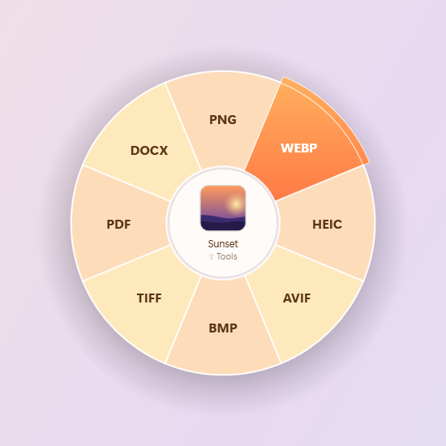
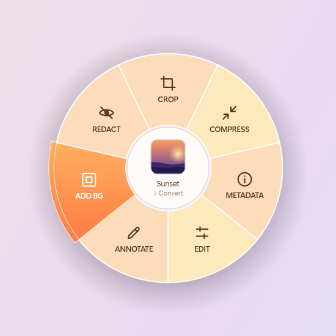
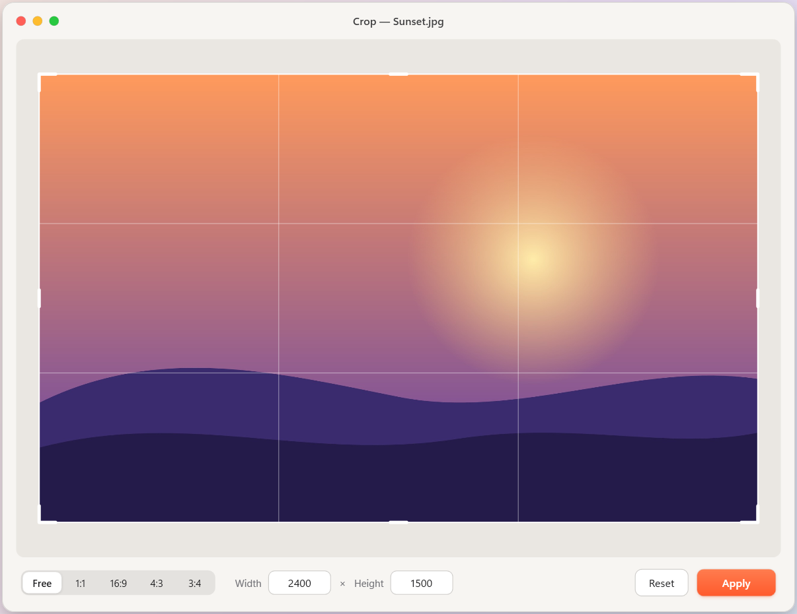
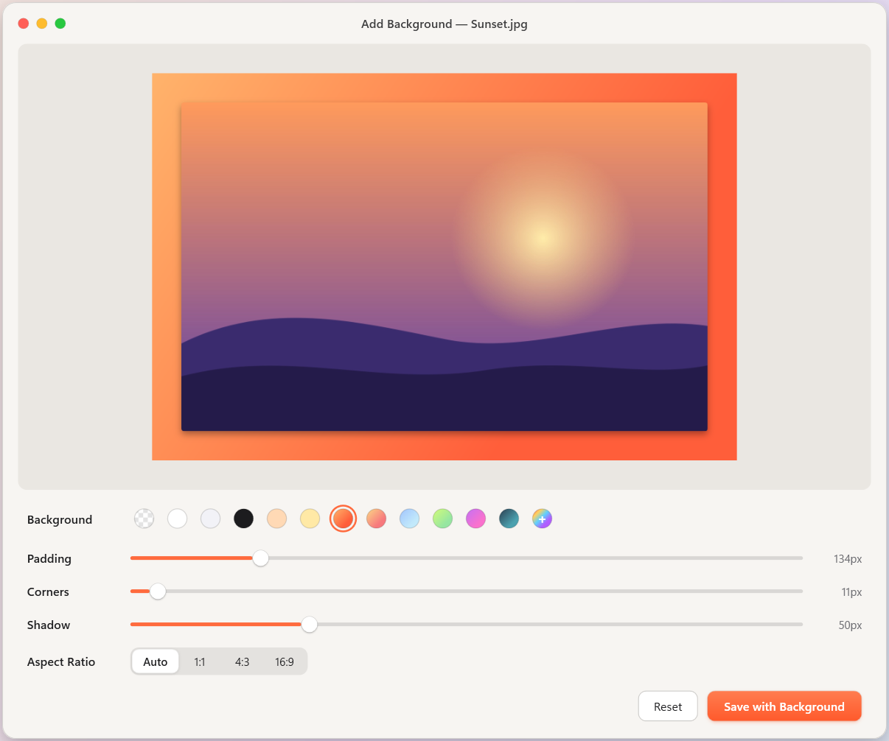

<p align="center">
  
</p>

<h1 align="center">Pitanga</h1>

<p align="center">
  <b>Drag a file. Tap Shift. Pick a format.</b><br>
  A radial menu for converting and editing files on Windows — with a macOS feel, and 100% offline.
</p>

<p align="center">
  
  
</p>

Converting a file usually means opening a website, uploading it, picking a format, waiting, and then hunting for
the result. Pitanga removes all of that: start dragging any file in Explorer or on the desktop, tap **Shift**, and a
frosted-glass menu opens around the cursor. Release over a slice and the new file appears **next to the original**.

> [Leia em português](docs/README.pt-BR.md)

## Features

| File | Menu |
|---|---|
| **Images** (JPG, PNG, WEBP, HEIC, AVIF, BMP, TIFF, GIF) | PNG · JPG · WEBP · HEIC · AVIF · BMP · TIFF · PDF · DOCX |
| **Images → Tools** (tap Shift again) | Crop · Compress · Metadata · Edit · Annotate · Add Background · Redact |
| **PDF** | DOCX · JPG · PNG · TXT · Merge (several PDFs) |
| **Word** (DOCX, DOC, RTF, ODT) | PDF · DOCX · JPG · PNG · TXT |
| **Excel** (XLSX, XLS, CSV, ODS) | PDF · XLSX · CSV |
| **PowerPoint** (PPTX, PPT, ODP) | PDF · PPTX · JPG · PNG |
| **Video / audio** *(needs `ffmpeg.exe`)* | MP4 · MOV · WEBM · GIF · MP3 / WAV · M4A · FLAC · OGG |

- **Never overwrites** anything: `photo.jpg` → `photo.png`, `photo_Cropped.jpg`, `photo (2).png`…
- **Private by design:** no network access, no telemetry. See [PRIVACY.md](PRIVACY.md).
- **Light:** ~50 MB of RAM while idle in the tray; heavy work runs in short-lived worker processes.
- Office documents are converted by **your installed Microsoft Office** (full layout fidelity), with macros disabled.

<p align="center">
  
  
</p>

## Install

1. Download **`Pitanga-Setup-<version>.exe`** from [Releases](../../releases) and run it — no admin rights needed.
   A portable `.zip` is also available.
2. Pitanga lives in the system tray (the pitanga icon near the clock) and can start with Windows.

> Windows may show **"Windows protected your PC"** because the installer is not code-signed yet.
> Click **More info → Run anyway**. Verify the download against `SHA256SUMS.txt` if you like.

Requirements: Windows 10 1809+ or Windows 11, x64. Office/LibreOffice only for document conversions.

## How to use

1. Start dragging a file (Explorer or desktop).
2. While still holding the mouse button, **tap Shift** — the menu opens with the cursor at its center.
3. Move toward a slice and **release**.
   - Release on the **center** to cancel. `Esc` closes the menu.
   - For images, **tap Shift again** to switch between *Convert* and *Tools*.

Command line (scripts, "Send to"):

```powershell
Pitanga.exe --convert JPG "C:\docs\report.pdf"
Pitanga.exe --tool CROP "C:\photos\beach.jpg"
```

## Build from source

Requires the [.NET 10 SDK](https://dotnet.microsoft.com/download) (and [Inno Setup 6](https://jrsoftware.org/isinfo.php) for the installer).

```powershell
git clone <this repo> C:\dev\Pitanga   # keep the path short — long paths break the XAML compiler
cd C:\dev\Pitanga
.\build.ps1 -Version 1.0.0              # → artifacts\: Pitanga-Setup, portable zip, SHA256SUMS
```

Pushing a tag like `v1.0.0` builds everything on GitHub Actions and publishes a release
([`.github/workflows/release.yml`](.github/workflows/release.yml)).
Microsoft Store packaging: [docs/STORE.md](docs/STORE.md) · Code signing: [docs/SIGNING.md](docs/SIGNING.md).

## How it works

- **Trigger:** low-level mouse/keyboard hooks on a dedicated thread detect *left button dragging + Shift*.
  The menu window then appears under the cursor and becomes the **OLE drop target** — Windows itself hands it the
  dragged file in `DragEnter`, no undocumented APIs needed.
- **Your original is safe:** with Shift held, Explorer proposes *Move*; Pitanga always answers *Copy/Link*, so the
  source file is never deleted.
- **Glass with a truly round edge:** the area behind the menu is captured with GDI into a reused buffer, blurred once
  (3-pass box blur), and clipped with an anti-aliased ellipse.
- **Lean tray process:** the always-on process renders in software (no Direct3D, ~70 MB saved) and never loads
  ImageMagick, Office or PDF libraries — conversions and tool windows run as `Pitanga.exe --convert/--tool` workers
  that exit when done.
- **Sticky Keys:** tapping Shift five times would trigger the Windows Sticky Keys prompt; while the menu is open
  Pitanga pauses only that *shortcut* and restores it right after (unless you use Sticky Keys).

Source layout: `src/Pitanga/` — `Input/` (hooks), `Menu/` (radial menu), `Conversion/` (PDF, images, Office,
media), `ImageOps/`, `Tools/` (Crop, Add BG, Edit, Annotate/Redact, Metadata), `UI/` (macOS-style window, toasts,
native tray icon).

## Credits

Inspired by **Tangerine** for macOS, by Thameem — Pitanga is an independent implementation for Windows.
Built with [Magick.NET](https://github.com/dlemstra/Magick.NET) / ImageMagick,
[PdfPig](https://github.com/UglyToad/PdfPig), the [Open XML SDK](https://github.com/dotnet/Open-XML-SDK) and the
native Windows PDF renderer. See [THIRD-PARTY-NOTICES.md](THIRD-PARTY-NOTICES.md).

## License

[MIT](LICENSE) © 2026 GusGk
